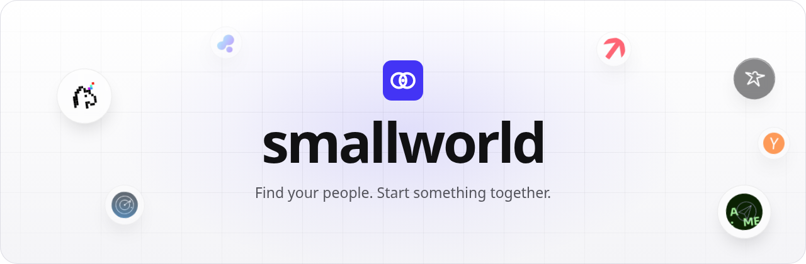

<div align="center">



<br>

[](package.json)
[](convex/)
[](tsconfig.json)
[](tests/)
[](LICENSE)

**Find your people. Start something together.**

[**Run it locally**](#run-locally) · [**The loop**](#the-loop) · [**API**](#api) · [**Privacy**](#data--privacy)

</div>

---

Community leads know their members as phone numbers. Nobody gets introduced, threads
die, and finding a good panellist means asking around.

Small World fixes the "who should I talk to" problem with consent-first people
discovery. An organizer types a concrete goal — *"find someone who knows robotics
and can hack on hardware"* — and gets back up to three people and two communities,
each with quoted evidence and honest caveats. One click proposes a small circle
with a purpose and a first activity. Invitees join or decline through a link that
leaks nothing. The circle goes live when enough people say yes.

Every recommendation cites its evidence. Fictional demo data is labelled as such.
Real community data only appears after members explicitly opt in.

## What it does

| | |
| --- | --- |
| **Grounded discovery** | Goals are matched against opt-in contributions and approved summaries — never scraped profiles, never inferred traits. Each result shows the evidence excerpt it came from, plus caveats like "availability unknown". |
| **Connections & speakers** | `mode: connections` finds collaborators; `mode: speaker` finds panellists and demo candidates with proof of what they've built. |
| **Circle proposals** | The organizer picks people from a saved search; the system drafts a circle with a purpose and first activity. The creator is host and member one. |
| **Explicit invitations** | Join/decline links are hashed, expire in 24h, and are shown exactly once. Public previews show no other invitees, no private evidence, no raw context. Duplicate joins are idempotent; seats are allocated atomically. |
| **Activation, not vibes** | A circle turns `active` only when enough members accepted *and* the first activity is confirmed. Pending invites don't count. |
| **Communities directory** | 12 London communities ship as `listed` with verified public links. They become `participating` only through real opt-in onboarding. |

## The loop

```
goal → 3 people + 2 communities (with evidence) → proposed circle
     → invite links out → explicit join/decline → activity confirmed → active
```

## Run locally

Node.js 22.12+ and npm. The first Convex run downloads a local backend — no account needed.

```bash
npm install
cp .env.example .env.local
npx convex dev --local          # keep running; terminal 1
```

```bash
npm run platform:env            # writes CONVEX_URL / keys into .env.local
npm run seed                    # 12 communities + labelled fictional members
npm run dev                     # terminal 2 → http://localhost:3000
```

Open http://localhost:3000. The demo signs you in automatically — there is no
password. The sample workspace ships with a
robotics-goal search (`demo-search-robotics`) so discovery works immediately.
`POST /api/platform/demo/reset` rebuilds fictional data; live data is untouched.

## API

All responses are `{ data, requestId }` or `{ error: { code, message, retryable }, requestId }`.
Organizer session: `POST /api/platform/session` (open demo, HttpOnly cookie, no password).

| Endpoint | Purpose |
| --- | --- |
| `GET /api/platform/bootstrap` · `GET /api/platform/communities` | Viewer context and directory |
| `POST /api/intelligence/discover` | Grounded people/community recommendations |
| `GET /api/platform/searches/:id` | Viewer-owned search snapshot (30 min) |
| `POST` / `GET /api/platform/circles` · `GET` / `PATCH /api/platform/circles/:id` | Create, list, detail, activity |
| `GET /api/platform/invitations/:token` | Read-only public preview — never mutates |
| `POST /api/platform/invitations/:token/respond` | Explicit join/decline, idempotent |
| `POST /api/platform/contributions` | Opt-in contribution via capability token |

## Data & privacy

- Only opt-in contributions and approved summaries are matchable. No raw chat text,
  no contact details, no inferred personality or sensitive traits.
- Fictional sample data is explicitly labelled; real communities stay `listed`
  until genuinely onboarded.
- Invitation tokens are 32 random bytes stored as HMAC-SHA256 hashes, returned once.
- Admin keys stay server-side; anonymous callers cannot reach internal Convex
  functions. Sample mode without `CONVEX_URL` runs on an isolated in-memory fixture.

## Verify

```bash
npm test                # 198 tests: routes, Convex invariants, intelligence, UI
npx tsc --noEmit
npm run build
npm run platform:smoke  # needs the local Convex backend running
```

## License

[MIT](LICENSE) — built for the Grok Bot Community Engineering London Hackathon.
