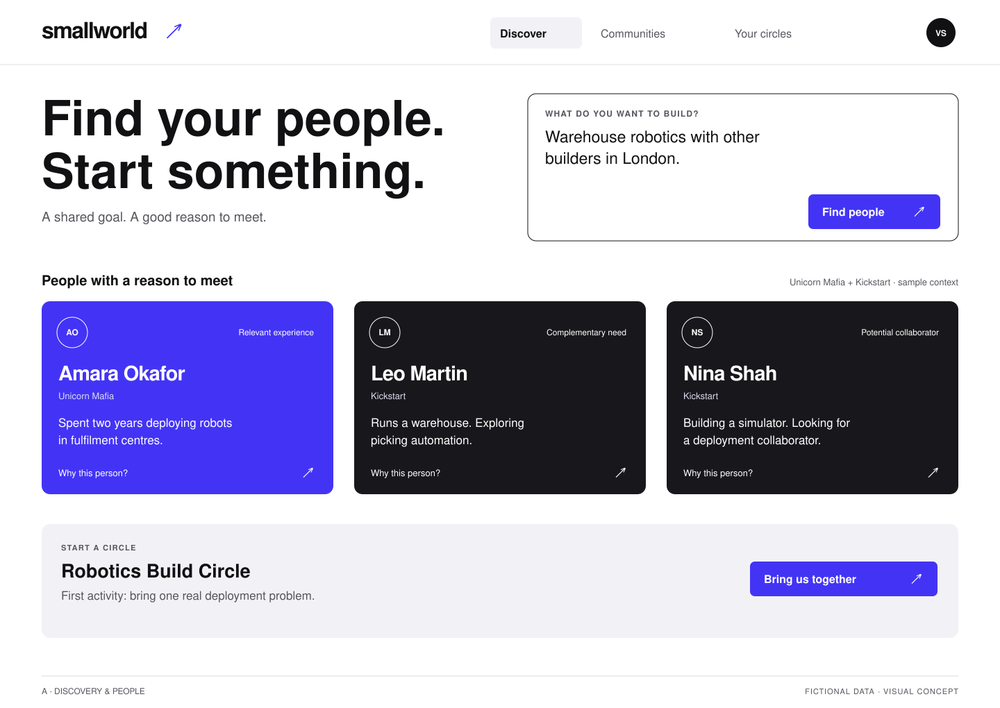
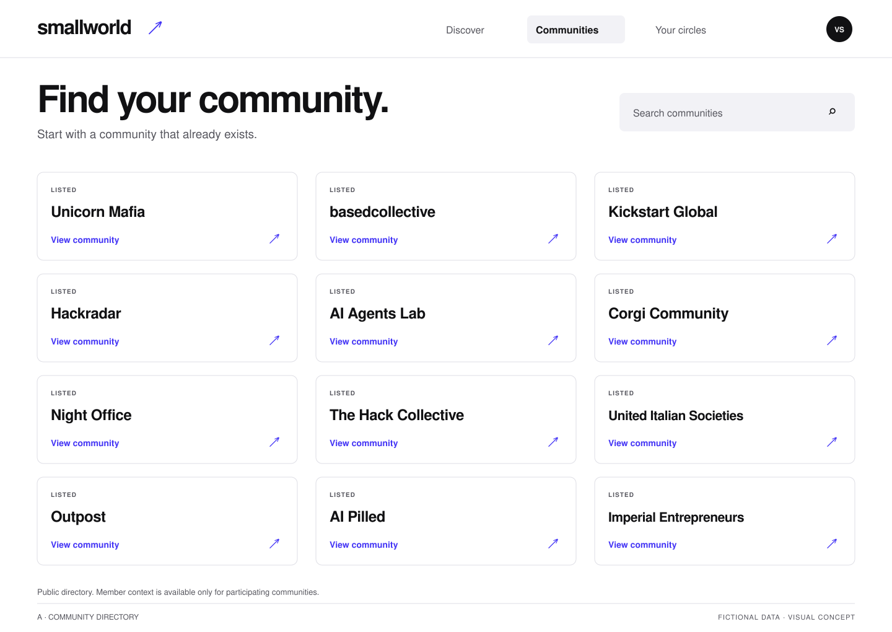
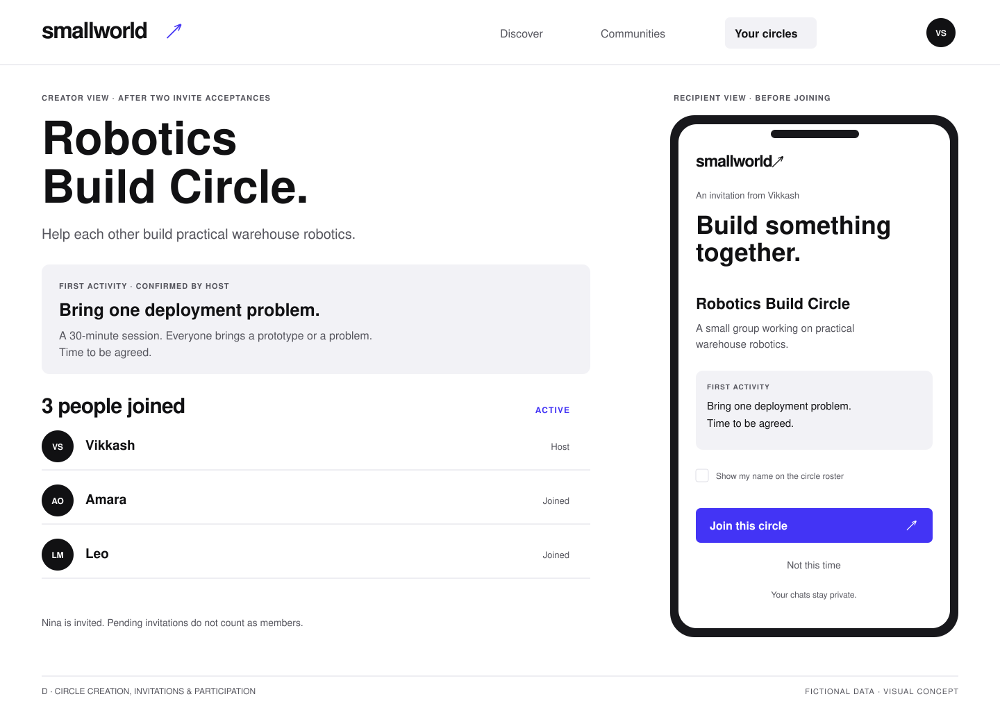

# Small World — Product Requirements Document

**Version:** 1.1 · 22 October 2026  
**Hackathon track:** Track 2 — Know Your Members  
**Product promise:** Find your people. Start something together.  
**Team model:** Four parallel implementation tracks, one frozen shared contract.  
**Status:** Build specification and visual concepts; the application is not implemented by this document.

This supersedes the earlier Relay plan for product scope and interface direction. Preserve its useful parsing/evidence safeguards, but use this document's circle-creation workflow, updated judging requirements, and ownership rules.

## 1. What we are building

Small World helps people discover relevant people and communities, then form a small, purposeful circle around something they want to build, learn, or do.

A member describes a goal. Small World finds up to three participating people with relevant evidence and up to two existing communities. It proposes a circle with a purpose and first activity. The creator reviews it, creates the invitation, and participants choose to join.

**Core loop:** goal → relevant people and community → proposed circle → invitation → accepted participants → first activity.

The outcome is a small group agreeing to do something together. Generating profiles, graph nodes, or a group description alone is not a successful outcome.

### The 15-second pitch

“Your next collaborator is probably already in one of your group chats. Small World finds people with a reason to meet, helps you find the right community, and brings you together around a first project or session.”

### Target user and customer

- **Member:** needs help, collaborators, feedback, or a peer group around a concrete goal.
- **Community organiser:** wants useful introductions, better member activation, and small activities that do not require constant manual matchmaking.
- **First likely buyer/operator:** a community lead running Small World for their community. The hackathon prototype uses one organiser workspace across participating communities.

### Example

Vikkash enters: “I want to build warehouse robotics with people in London.”

The product returns a member who has described deployment experience, a member who has described a warehouse automation problem, and a member seeking a robotics collaborator. It suggests an existing community based on that community's documented focus, not its name alone. Vikkash reviews a proposed “Robotics Build Circle” with a first session: each participant brings one real deployment problem. Invited members join on their phones.

All people/messages in the supplied mockups are fictional. Suggested affiliations and future collaborations do not imply any community has endorsed or connected to Small World.

## 2. Hackathon alignment and submission requirements

The hackathon website was inspected on 22 October 2026, including all six track briefs, the data kit, and submission form.

Track 2 asks for opt-in member understanding, a member graph, useful introductions, speaker discovery with evidence, or revived conversations. Its example winning demo includes an end-to-end introduction or revived thread followed by a grounded speaker shortlist. Our core is grounded introductions and group formation; speaker search is a low-cost stretch using the same engine, not a second product.

The current website lists six shared criteria; track briefs say each is scored 1–5:

1. Technical execution.
2. Open source, and whether another community could run it next week.
3. Use of community context.
4. Improvement over what leads use today.
5. Real-world usefulness.
6. Demo quality.

Keep evidence of actual Grok Bot/Cursor contributions, although the newer website's shared list replaces the older standalone architecture criterion with open-source/reusability.

**Required submission:** public GitHub repo; MIT, Apache-2.0, or AGPL-3.0 LICENSE; demo video under three minutes; team details; optional live demo URL. Code freeze: **21:50 Europe/London**. Do not submit or publish private datasets in the repository.

**Practical proof:** another organiser can clone the repo, add environment variables, seed fictional data, and run the complete flow. A basic README, migrations, seed command, and `.env.example` are deliverables, not optional polish.

## 3. Scope: tonight versus later

### P0 — must work

- A curated directory containing all 12 named community partners, with verified public links and explicit participation status.
- A small fictional dataset plus opt-in member contributions or an agreed imported sample.
- A goal search that returns zero to three grounded people and zero to two relevant communities.
- An evidence view for each person; unsupported matches must not be fabricated.
- A suggested circle with name, purpose, host, capacity, and first activity.
- Circle creation and member-specific invitation links.
- A phone-friendly join/decline flow, with accepted membership persisted and counted once.
- A circle page that shows progress and a clear next step.
- Server-side access controls and protection of private source context.
- A reliable fictional demo reset and a reproducible open-source setup.

### P1 — after the first end-to-end flow

- Approved WhatsApp text import and organiser review UI.
- Fresh contributions changing recommendations.
- A small explanation graph inside the evidence drawer.
- Topic-based speaker shortlist using the same people retrieval.
- One deliberate retry/resume path for model/import failure.
- Richer graph visualisation or additional Cognee retrieval modes after the core approved-summary memory path works.

### Later

Continuous chat sync, automated WhatsApp group creation, full messaging, event ticketing, venue search, sponsor matching, automatic scheduling, recurring weekly introductions, full multi-workspace tenancy, personalised member agents, large animated graph, billing.

**Important distinction:** P0 creates an in-app circle and invitation page. It does not automatically create a WhatsApp group, open a Discord server, book a venue, or confirm a meeting time. Manual external links can be attached later.

### Cut order

Live connectors → avatar → explanation graph → speaker mode → chat import. Timebox Cognee setup; use the labelled local retrieval fallback only if Cloud integration cannot be made reliable in time. Preserve member contributions, discovery, circle creation, invitations, join response, and the demo.

## 4. Principles for the interface

The user explicitly rejected dense dashboards, faded green, excessive labels, and unnecessary explanatory content. The product must feel bold, direct, and intentional.

- **One dominant action per state:** Find people → Bring us together → Join circle.
- **Progressive detail:** one relevant reason per person; evidence appears under “Why?”.
- **Strong hierarchy:** large sans-serif headline, readable names, crisp spacing, electric blue and high contrast.
- **No default graph dashboard:** the graph explains a decision on request.
- **No invented metrics:** no compatibility percentages, community health gauges, or generated engagement stats.
- **Honest states:** suggested, invited, joined, and active mean different things.
- **Community-first:** preserve the source community's identity, support existing communities, and make new circles purposeful.
- **Phone-first participation:** joining requires a short, clear confirmation, not a second onboarding funnel.

## 5. Visual mockups and design specification

These are exact-layout visual concepts for implementation, not screenshots of a working app. They establish hierarchy and flow; visible people/messages are fictional.

### Screen A — Discover



**Primary question:** “What do you want to build?”

- Compact header: Small World; Discover / Communities / Your circles.
- Goal input is dominant and immediately usable.
- Three person results: name, parent community, one reason, Why? action.
- One concise community recommendation when evidence supports it; omit if none.
- One bottom action, **Bring us together**, creates a reviewed circle proposal.
- Initial empty state shows one example goal. The mockup shows a completed sample search.
- Do not add metrics, a news feed, a persistent assistant chat, or more filter bars.

### Screen B — Communities



- All 12 named communities are present in the directory.
- Search/filter by documented focus; curated tags require a source or organiser approval.
- Each item has its name, one-line description if verified, status, and an actual verified public link.
- “Listed” means public metadata only. “Participating” means contributed context is allowed. “Connected” means a configured integration exists.
- Clicking View community opens a compact detail panel with purpose, how to join, and relevant approved circles.
- Do not imply endorsement, shared member data, or partner status with Small World merely because a community is listed.

### Screen C — Circle invitation and accepted state



- The invitation page presents the circle name, purpose, proposed host, capacity, and first activity.
- Participation CTA: **Join this circle**. Secondary action: Decline.
- After joining, the person receives a confirmation and accepted count updates in the creator view.
- Display identities/avatars publicly only when that participant permits roster visibility; otherwise show an anonymous count.
- A proposed date is labelled as proposed. No calendar booking is implied.
- The mockup juxtaposes recipient and creator states to show the flow; the shipped phone screen contains only the recipient view.

### Tokens

| Token | Light | Dark | Use |
|---|---|---|---|
| Background | `#FFFFFF` | `#111113` | Main canvas |
| Foreground | `#111113` | `#FFFFFF` | Headlines/body |
| Brand | `#4334F5` | `#8274FF` | Primary action/highlight |
| On brand | `#FFFFFF` | `#100C2B` | Button text |
| Secondary text | `#55555D` | `#B9B9C3` | Supporting labels |
| Border | `#DEDEE5` | `#3B3B42` | Structural separation |
| Tile | `#18181C` | `#25252B` | Person result surface |

Use a system sans or a single installed/available font such as Inter. Headline 56–68px desktop / 36–44px mobile; body 15–16px; secondary 12–13px. Controls at least 44px tall on touch. Card radius around 12px. Keep body contrast readable and test keyboard focus. No gradient haze or colour-coded badges on every row.

### Routes and frontend ownership

| Route | Purpose |
|---|---|
| `/` | Goal and discovery results |
| `/communities` | Directory and details |
| `/circles` | Creator's draft/live circles |
| `/circles/[id]` | Creator circle detail, authenticated |
| `/invite/[token]` | Recipient preview and join/decline |
| `/contribute/[token]` | Optional short member contribution |
| `/admin/context` | Optional approved import/review |

Page routes are split between A (discovery, communities, context review) and D (circles, invitations, contributions). API routes are split by namespace between B and C. The exact ownership table below is authoritative.

## 6. User flows and exact states

### F1: Goal to recommendations

1. Authenticated organiser/member enters a goal and selects eligible participating communities, defaulting to their allowed scope.
2. Track B retrieves permitted approved signals and relevant public community summaries.
3. It returns zero to three people, zero to two communities, and a circle proposal if there is sufficient shared purpose.
4. Results display reasons and availability caveats; “Why?” reveals only authorised evidence.
5. With no grounded people, show an honest empty result and offer a contribution or community discovery. Do not manufacture a circle roster.

### F2: Recommendations to circle

1. Creator clicks Bring us together.
2. Review sheet contains circle name, purpose, proposed first activity, selected people, and capacity; creator is the host by default.
3. Creator edits and confirms. Draft generation is not publication.
4. Platform validates the referenced search, candidate IDs, visibility, and capacity before saving.
5. Create an in-app circle and one invitation per selected member, returning token links only to the creator.
6. No external messages are sent automatically. Creator manually shares each intended link.

### F3: Recipient joins

1. Recipient opens their scoped link; GET is read-only.
2. Page shows the purpose and requested activity, not source chats or other invitees' private details.
3. Recipient chooses Join or Decline. Optional checkbox separately permits display of their name/avatar on the roster; default off for real data.
4. Explicit POST checks expiry, invitation state, circle state, and capacity in one transaction.
5. Unique membership constraint prevents duplicate joins; repeated submissions return the existing result.
6. Creator polls every three seconds; accepted count reflects the database.

### F4: Circle becomes active

Use this definition: circle is **forming** after creation; it becomes **active** only when the host has confirmed the first activity and the minimum accepted membership is met. Default minimum: host plus two accepted invitees. Invited people are never counted as members.

The creator can confirm or edit the activity. Do not claim a scheduled event when its date/time is undecided. A shared activity can be “bring one prototype to a 30-minute review; time to be agreed.”

### States

| Entity | Allowed states |
|---|---|
| Community | listed / participating / connected |
| Signal | pending / approved / rejected / withdrawn |
| Search | ready / empty / unavailable |
| Circle | draft / forming / active / archived |
| Invitation | pending / accepted / declined / expired / revoked |
| Membership | active / left |

Circle creator is a confirmed active member at creation. Invitation acceptance adds one membership, never another copy of the host.

## 7. Functional requirements and acceptance

| ID | Requirement | Acceptance evidence | Owner |
|---|---|---|---|
| FR-01 | List all 12 communities | Directory returns 12 stable IDs with verified links; no unverified affiliation claims | C data; A UI |
| FR-02 | Opt-in contributions | Explicit professional fields create pending signals; permission scope captured | C |
| FR-03 | Goal search | Validated result contains only permitted people/evidence, max 3 people and 2 communities | B |
| FR-04 | Evidence view | Every displayed statement has a supplied valid evidence ID and permitted summary/excerpt | B data; A UI |
| FR-05 | Circle proposal | Concrete purpose/activity; no invented participant agreement | B |
| FR-06 | Review/create | Creator can edit; platform rejects inaccessible or altered candidate IDs | C API; D UI |
| FR-07 | Invitations | Random expiring per-recipient capabilities; private source content omitted | C |
| FR-08 | Join/decline | GET cannot join; POST is transactional, capacity-aware, idempotent | C API; D UI |
| FR-09 | Live membership | Creator count/roster updates after valid acceptance | C API; D polling |
| FR-10 | Community discovery | Directory includes accurate status; application/join link opens intended verified destination | C data; A UI |
| FR-11 | Demo mode | Fictional workspace clearly labelled and isolated from real data | All via contracts |
| FR-12 | Reusability | Fresh clone + migrations + seed + env runs the vertical slice | C lead; A/B/D docs |

## 8. Data sources, scope, and provenance

### Seed directory

Use these 12 names with stable slugs. This list comes from the hackathon site, not a claim that every community is onboarded:

`unicorn-mafia`, `basedcollective`, `kickstart-global`, `hackradar`, `ai-agents-lab`, `corgi-community`, `night-office`, `the-hack-collective`, `united-italian-societies`, `outpost`, `ai-pilled`, `imperial-entrepreneurs`.

Start all real communities as listed. Mark participating/connected only after the corresponding setup is actually completed. Fictional fixture memberships may reference these names only with a clear sample-data label; do not attribute invented historical statements to real group chats.

### Member inputs

P0 input is a short opt-in form: what are you building; what can you help with; what are you looking for; optional availability; intended discovery scope. Capture source timestamp and visibility. Contact information is not required for model matching.

P1 import: agreed WhatsApp sample without media. Parse locale/date order explicitly; handle multiline messages, timestamps/timezones, system messages, phone-number pseudonyms, and repeated imports. Limit to roughly 500 selected messages/2MB initially. Unknown dates stay unknown. Sources are private, and claims are pending until reviewed.

Do not use a personal Discord token or derive the people graph from historical Discord API data; the developer policy restricts user/relationship profiling. Direct contributions are the practical starting point. External/public evidence may be linked to a member-confirmed handle rather than guessed identity.

The hackathon briefs say The Hack Collective has synthetic profiles and a consented subscriber export; Unicorn Mafia has consented context and bot access available to ask about in the room. These are offers to discuss, not data already supplied or permission to publish names/emails.

### What can be inferred

Allowed: explicitly stated professional experience; project; request; offer; topic interest; availability. Label inference and uncertainty where appropriate.

Not allowed by this product: invented friendship edges, expertise inferred from an event link, identity merges from same names, inferred personality or sensitive traits, available-now claims based on old offers, and member speech generated as though authored by the person.

## 9. Intelligence and graph requirements

### Pipeline

1. Receive goal, selected community scope, and trusted viewer from server auth.
2. Call the platform port to retrieve approved evidence already filtered for that viewer.
3. Parse intent: help, collaboration, peer group, or optional speaker search.
4. Retrieve candidate evidence IDs through Cognee over approved professional summaries. Intersect them with the current permission-filtered platform records. Use explicit tags/keywords as a tested fallback, not as an undisclosed replacement for Cognee.
5. Rerank at most 20–30 people with bounded evidence using a structured model response.
6. Validate all member IDs, evidence IDs, exact excerpts where applicable, scope, current availability, and contradictions.
7. Produce distinct practical reasons and caveats, zero to three people, zero to two community fits.
8. Propose a circle only when the goal and candidate set support one. Give it a concrete first activity.
9. Save the validated search snapshot through the platform port and return the shared response DTO.

No fabricated percentage scores. No network of inferred real relationships. Source messages are untrusted data; their instructions must not change the agent's rules or cause tools to run.

### Graph

Underlying graph: person → building/seeking/offering/experience → topic/project; claim → evidence; member-confirmed membership → community. A suggested connection is a recommendation edge, not an existing relationship.

P0 uses Supabase as the authoritative record and Cognee Cloud as the intended graph-memory/retrieval layer for approved professional summaries. P1 can visualise 6–12 selected nodes in the evidence drawer. Platform scope checks and evidence validation remain authoritative. No additional graph database is needed.

### Cognee Cloud implementation boundary

Track B owns `src/server/intelligence/memory/**`, the Cloud adapter, and integration notes. Track C owns only credentials/deployment configuration and authoritative context storage. A/D receive the same DTOs regardless of backend and show a concise sample/fallback indicator where needed.

1. Obtain the API key through Cognee's own dashboard; store it only in the server environment. Do not send credentials through the PRD, repository, or team chat.
2. Read the current Cloud documentation/tenant API instructions and prove a small approved sample can be indexed and retrieved. Do not hardcode a remembered endpoint or mix current SDK verbs with a legacy Cloud schema. The current Python quickstart uses `remember` and `recall`; Cloud API paths/auth must be checked against the actual tenant.
3. Index member-approved professional summaries tagged with memberId, signalId, evidenceId, scope, and context revision. Do not index raw private chats or contact details by default.
4. Partition datasets by permitted discovery scope; cross-community datasets contain only specifically approved cross-community summaries. Request only datasets the viewer may use.
5. Maintain an active index revision aligned with the authoritative approved-context snapshot. B can derive its revision key from a sorted hash of the current permission-filtered member/signal IDs, content, availability, and scope returned by the platform port, without changing C's DTOs. Never query an obsolete dataset after a withdrawal or scope change; invalidate it, use current local retrieval until a rebuilt revision is ready, and remove obsolete material from Cloud.
6. Treat returned graph relationships/text as retrieval hints. Map IDs back to current platform records and validate evidence before reranking/rendering. Invented nodes or relationships never become product facts automatically.
7. Index once per revision, query many times, cap retrieved candidates, cache by goal/scope/revision, and avoid an unbounded agent loop. Check actual usage after the initial small run; the available credit is not a promise of a specific workload size.
8. Return `retrievalBackend: cognee | local` in DiscoverResponse. Fallback is explicit. Backend choice does not change candidate/evidence permissions or circle creation contracts.

### Performance budgets

Targets to measure, not vendor guarantees: cached discovery under 2 seconds; fresh inference under 12 seconds; circle creation under 2 seconds; phone join under 2 seconds; creator refresh within 3 seconds. Display actual stages and a retry state. Persist successful results. A provider failure returns `unavailable`, never sample results pretending to be live.

## 10. Architecture and strict ownership

**One repository, one Next.js application, one Postgres database.** Parallelise by ownership boundaries, not four independent apps that need rebuilding at integration.

- Next.js + TypeScript + Tailwind; simple components/Lucide.
- Supabase Postgres accessed server-side; no browser service-role credentials.
- Server-side model calls with model ID in an environment variable.
- Polling for accepted membership; Realtime only if already working.
- Frozen contract types, fictional API responses, and minimal visual primitives; all four build against these immediately.

### Four implementation tracks

| Track | Mission | Owns | Must not edit |
|---|---|---|---|
| **A — Discovery & community interface** | Goal search, people, evidence, existing communities | Home, community directory/details, evidence drawer, context-review UI, root shell/design tokens, discovery client adapter | Circle/invitation pages, API handlers, server logic, SQL, frozen contracts |
| **B — Context & intelligence** | Grounded matches and concrete circle proposals | `/api/intelligence/**`, extraction/matching/validation domain and tests | All UI, platform/auth/store, SQL, root configuration, frozen contracts |
| **C — Platform & integration** | Persistence, auth, directory, circle/invitation APIs, deployment | `/api/platform/**`, platform port/store, all SQL/seeds, root tooling, shared-contract amendments | Product pages/components, intelligence logic |
| **D — Circle creation & participation interface** | Turn matches into a group that opts in and starts an activity | New-circle review, creator list/detail, phone invitation/join, contribution UI, circle client adapter | Discovery/community UI, root shell/global CSS, API/server/SQL, frozen contracts |

C is integration lead and sole owner of package.json, lockfile, shared environment templates, migrations, README, and release configuration. A owns the common visual shell/tokens after bootstrap. D uses those read-only primitives and owned CSS modules; D never changes global styles to fix its page.

### Exact paths

| Path | Owner |
|---|---|
| `src/app/(product)/page.tsx`, `src/app/(product)/communities/**`, `src/app/(product)/admin/context/**` | A |
| `src/app/layout.tsx`, `src/app/globals.css`, `src/components/shell/**`, `src/components/discovery/**`, `src/components/communities/**`, `src/ui/discovery/**`, `tests/discovery-ui/**` | A |
| `src/app/api/intelligence/**`, `src/server/intelligence/**`, `tests/intelligence/**` | B |
| `src/app/api/platform/**`, `src/server/platform/**`, `tests/platform/**` | C |
| `supabase/**`, `scripts/**`, `.env.example`, root configs, README, LICENSE | C |
| `src/app/(product)/circles/**`, `src/app/(product)/invite/**`, `src/app/(product)/contribute/**` | D |
| `src/components/circles/**`, `src/ui/circles/**`, `tests/circle-ui/**` | D |
| `src/shared/contracts.ts`, `src/shared/fixtures/**`, `src/ui-kit/**` | Frozen baseline; C applies agreed amendments only |

Do not create a competing `src/app/page.tsx`. Do not create another `(product)/layout.tsx` in D's track; A owns the shell through root layout. Avoid barrel exports spanning separately owned folders.

### Dependencies and handoff seam

- A calls B discovery and C bootstrap/directory APIs. It sends no trusted viewer IDs.
- A's Bring us together action navigates to **`/circles/new?searchId=<encoded searchId>`**. A does not create the review sheet or circle state.
- D reads that search through **`GET /api/platform/searches/:id`**, then renders/reviews the returned CircleDraft. Do not pass private results, raw messages, or JSON state in the URL.
- D calls C's create/list/detail/activity/invitation APIs. D does not rerun matching or create a second candidate store.
- B imports `requireOrganizer` and `getPlatformPort` from `src/server/platform/public.ts`. C owns the implementation; B injects a local port in tests.
- C imports no A/D component or B matcher. API/port implementations remain independently testable.
- A and D each own their API adapters/mocks in their folders and consume identical frozen DTOs. `NEXT_PUBLIC_DATA_MODE=mock|live` must not silently change on error.
- C provides a fixture port early, then swaps Postgres behind the same exports.

### Shared changes

The first 10–15-minute bootstrap is intentionally sequential. After freeze, all four have separate editable files. A defines minimal visual tokens/Button/Input primitives during bootstrap; C commits these under the frozen ui-kit baseline. D can use them immediately without waiting for A's pages.

If a contract or primitive must change, propose the exact change to C. C applies one announced commit. Nobody independently forks types, changes global CSS, or edits another track's route to fix integration.

## 11. Frozen contract: read before coding

The accompanying `shared/contracts.ts` is the machine-readable baseline. Use camelCase externally, ISO UTC dates, explicit nulls for missing optional values, stable string IDs, and these envelope rules:

- Successful HTTP response: `{ data: T, requestId: string }`.
- Error: `{ error: { code, message, retryable }, requestId }`.
- Model structured output must be validated before conversion to DTOs.
- Caller never submits a trusted `viewerId`, workspace membership, or permission scope.
- `dataMode` is returned by the server and displayed by A.

### HTTP endpoints

| Method/path | Owner | Request → response |
|---|---|---|
| `POST /api/platform/session` | C | password → session cookie; no secrets in response |
| `GET /api/platform/bootstrap` | C | session → BootstrapResponse |
| `GET /api/platform/communities` | C | permitted/public view → Community[] |
| `GET /api/platform/searches/:id` | C | viewer-owned valid search → SearchPreviewResponse (D handoff) |
| `POST /api/platform/contributions` | C | scoped contribution token + explicit form fields → pending ID |
| `POST /api/intelligence/discover` | B | DiscoverRequest → DiscoverResponse |
| `POST /api/intelligence/import/preview` | B/P1 | approved text/options → redacted parsed preview |
| `POST /api/intelligence/import/commit` | B/P1 | selected canonical messages → ImportResult with pending claims |
| `POST /api/intelligence/signals/review` | B/P1 | selected IDs/decision → reviewed counts |
| `POST /api/platform/circles` | C | CreateCircleRequest → CreateCircleResponse |
| `GET /api/platform/circles` | C | creator session → CircleSummary[] |
| `GET /api/platform/circles/:id` | C | creator session → CircleDetail |
| `PATCH /api/platform/circles/:id/activity` | C | activity + confirmed → CircleDetail |
| `GET /api/platform/invitations/:token` | C | possession of token → InvitationView |
| `POST /api/platform/invitations/:token/respond` | C | InvitationResponseRequest → InvitationResponse |
| `POST /api/platform/demo/reset` | C | organiser + fictional workspace → reset confirmation |

P1 endpoints do not block P0 integration. Freeze only the P0 schema at kickoff; B and C may jointly specify P1 importer methods later without changing discover or circle DTOs.

### Validation behaviour

- 400: malformed input. 401: missing session. 403: unavailable scope. 404: nonexistent or inaccessible private record. 409: capacity/state conflict. 410: expired/revoked capability. 429: expensive request throttled. 503: provider unavailable.
- For discover, an empty result is 200 with `status: empty`. Provider failure is an error, not an empty result.
- Circle creation uses the server-saved validated search snapshot; the client may select a subset but cannot add arbitrary candidate IDs.
- The creator selects 1–3 suggested invitees; defaults capacity 6, minimum 3 including host. Capacity cannot be below host + number already accepted.
- Circle proposal is optional. When none exists, Bring us together is unavailable and the interface explains what input is missing.

## 12. Database and security ownership

C owns every migration and every DB client. B does not create a second signal store or make SQL changes independently.

| Table | Main data |
|---|---|
| `communities` | stable id, public metadata, verified URL, status, focus tags + provenance |
| `members` | internal identity, display name, opt-in state, public roster preference |
| `memberships` | member-confirmed community affiliation; unique member/community |
| `sources` | source type, permitted scope, private redacted content, timestamps |
| `signals` | member, kind/topic, approved summary, evidence class, visibility, status, valid_until |
| `signal_evidence` | signal/source reference, permitted excerpt, author attribution |
| `searches` | viewer, workspace, goal, validated result, expiry, data mode |
| `circles` | creator/host, title, purpose, activity, capacity, minimum, status |
| `circle_members` | circle/member, role, joined_at, roster visibility; unique pair |
| `invitations` | circle, intended member, token hash, state, expires_at; unique circle/intended member |
| `audit_events` | minimal actor/action/object/status; no raw chat or tokens |

Workspace IDs remain explicit even with a single workspace. Enable RLS with no anonymous private-table policies. If a server service role is used, enforce permissions in every handler because it bypasses RLS.

For the hackathon, organiser login can be a server-validated password with expiring signed HttpOnly/Secure cookie, same-origin mutation checks, and login throttling. Real multi-member accounts can follow later; never fake authentication with a client-side password screen.

### Invitations

- 32 cryptographically random bytes or more; store only hash/HMAC.
- Default expiry 24 hours. Tokens returned to creator once; never expose in logs or broad listings.
- GET preview never mutates membership; link unfurlers routinely fetch links.
- Join/decline runs an atomic transaction locking/checking invitation and circle capacity.
- Duplicate accept returns the original membership. Accept and decline races resolve once.
- Forwarded link possession is not verified personal identity; describe acceptance as invitation-link confirmation. If stronger verification is required, add actual sign-in.
- Public response page contains no private evidence, emails, phone numbers, or unconsented roster.
- Scope of joining is explicitly shown. Name display consent is separate, optional, and not prechecked.

### Withdrawal/deletion

Withdrawn signals are excluded from future matching. Previously saved results using that evidence are invalidated before circle creation. Deleting a source removes unsupported derived claims. Existing circle membership is a separate opt-in record and does not silently disappear when an old chat excerpt is withdrawn; provide a leave route after the hackathon or organiser removal in P0.

## 13. Non-intersecting track briefs

Each of the four teammates receives this PRD, `shared/contracts.ts`, fixtures, all three mockups, and their track file. They can build against mocks without waiting for another feature implementation.

### Track A — Discovery & community interface

**Deliverable:** the bold entry experience and existing-community discovery. Build against frozen mocks, then live B/C APIs.

1. Root shell, typography/tokens, navigation and owned route group pages.
2. Goal form and up to three person cards, one practical reason each.
3. Why? drawer: permitted evidence, dates, caveats; optional small explanation graph.
4. Communities directory with all 12 names, accurate status, name search, verified links, and compact details.
5. Bring us together navigates to `/circles/new?searchId=...`; D owns all review/creation after that seam.
6. Optional approved-context review page after P0.
7. Live adapters, empty/provider-error states, keyboard/touch/mobile checks.

**Do not build:** circle pages, invitation flows, APIs, model calls, auth implementation, SQL, member stores, or a second shared UI kit.

**Acceptance:** discovery/directory work at 360/768/1440; evidence hidden until asked; raw source text absent from URL handoff; same typed response works with mock/live adapter; no dashboard clutter.

### Track B — Context & intelligence

**Deliverable:** independently testable grounded search and circle proposal service against an injected PlatformPort, plus its `/api/intelligence` handlers.

Build in this order:

1. Import frozen DTOs; create local test port implementing the contract from fixtures.
2. Deterministic baseline retrieval that finds the expected people and one relevant community or honestly none.
3. Goal interpretation, bounded model reranking, structured schema validation, and evidence verification.
4. Return distinct fit reasons and caveats; preserve expiry/visibility checks.
5. Generate a concise circle proposal with a concrete first activity and permitted candidates; persist validated search through the port.
6. Implement discovery route using C's guard and port exports.
7. Integrate Cognee Cloud behind the memory adapter once the deterministic baseline is tested; then add TXT import/review only if time remains.
8. Add speaker mode only if P0 grounding works; show evidence from member-contributed or confirmed public professional sources.

**Do not build:** frontend, SQL/migrations, auth implementation, circle persistence, public directory scraping, direct chat automation. Do not edit shared types independently.

**Acceptance:** no evidence IDs outside the permitted input; two same-name people stay distinct; no expertise from event shares; private cross-community sources are absent even from model input; unknown availability stays unknown; no-match works; provider failure is visible; stale evidence cannot support circle creation.

### Track C — Platform & integration

**Deliverable:** root scaffold, shared baseline, persistent directory/context port, organiser session, circle and invitation lifecycle, deployment/setup.

Build in this order:

1. Bootstrap root app, install shared dependencies, commit frozen contracts/fixtures/ui-kit and reserve all four namespaces.
2. Implement `public.ts` guard and PlatformPort with deterministic fixtures so B can integrate early.
3. Create migrations/seed for all domain tables; seed the 12 listed communities with verified links and separate fictional participant data.
4. Implement login/session, bootstrap/directory APIs, and simple opt-in contributions.
5. Replace fixture port with Postgres implementation behind the same interface.
6. Implement circle creation from stored validated search and per-recipient invitation creation.
7. Implement invitation preview and atomic join/decline; enforce capacity, scope, expiry, uniqueness.
8. Implement creator list/detail/activity update and fictional reset.
9. Deploy, run security/flow checks, finish README/env/LICENSE and collect release evidence.

**Do not build:** product pages, visual components, prompts, reranking, matching explanations, B's handlers. For missing feature contracts, coordinate a small shared change rather than writing a parallel implementation.

**Acceptance:** B can use the platform port; creator cannot add arbitrary people; GET cannot join; duplicate joins count once; two simultaneous final-seat joins cannot overfill; inaccessible circle IDs are denied; private source text never appears on invitations; another organiser can run the setup.

### Track D — Circle creation & participation interface

**Deliverable:** the second half of the core loop, entirely frontend, against C's APIs.

1. Build `/circles/new` using mocked SearchPreviewResponse; support the query-string searchId handoff from A.
2. Review/edit circle title, purpose, selected candidates, capacity, and first activity. Creator is host by default.
3. Create via C; display recipient-specific invitation links only in creator view, with copy/share actions and honest manual-delivery status.
4. Creator list/detail: pending and joined states, acceptedCount from server, activity confirmation, forming/active state.
5. Phone-friendly invitation: safe preview, deliberate Join/Decline POST, separate unchecked name-display consent.
6. Poll creator detail every three seconds while visible/forming; stop on unmount, background, or archived state.
7. Optional contribution form for permitted professional statements, calling C's endpoint.
8. Live adapter, token expiry/capacity/error states, mobile checks, demo rehearsal.

**Do not build:** discovery, community directory, root layout/global styles, server APIs, SQL, token security, or matching. Use read-only ui-kit primitives and owned CSS modules. Never claim a circle is active until C returns that state.

**Acceptance:** complete circle flow works against fixtures without B/C; then swapping to live adapters changes no view contract. Host+accepted invitees count accurately; duplicate requests do not inflate the UI; unknown date is labelled proposed/to be agreed; empty/invalid searchId has a safe recovery link.

## 14. Integration protocol

### First 10–15 minutes: one baseline commit

C scaffolds and commits Next.js, TypeScript, Tailwind, Lucide, validation library, test runner, paths/aliases, scripts, `.env.example`, contract and fixtures. A owns root layout/styles after this baseline. D owns only its circle-specific routes/styles. B may draft domain functions while waiting, but all branches start from this same commit.

Suggested branches: `track-a-discovery`, `track-b-intelligence`, `track-c-platform`, `track-d-circles`. Separate git worktrees or clones prevent agents sharing uncommitted files. One person resolves integration commits; teammates never force-push each other's branches.

### Checkpoints relative to start

| Time | A — discovery | B — intelligence | C — platform | D — circles UI |
|---|---|---|---|---|
| T+15 | Shell/tokens agreed | Port contract compiles | Baseline frozen/pushed | Mock DTOs and route seam compile |
| T+45 | Mock discovery/directory | Deterministic matching | Guard/fixture port/directory | Mock new-circle and invite views |
| T+90 | Evidence/live adapter ready | Validated live discovery | Postgres/search-preview/create | Mock creator/join/active flow |
| T+130 | Test handoff to D | Fix matching failures | Atomic join/auth complete | Switch to live C APIs |
| T+160 | Polish discovery/mobile | Evidence/failure checks | Deploy and integrate | Polish phone join/polling |
| Final 30–40 min | Rehearse | Genuine tool evidence | Freeze/release | Run two-device join demo |

Merge small vertical commits continuously. Do not wait until code freeze to discover inconsistent types. Each handoff includes changed owned files, exact API shape/example, how to run/check, and known limitations.

### Integration smoke test

1. Seed fictional workspace.
2. Log in; bootstrap lists 12 communities with sample mode.
3. Submit robotics goal; receive expected grounded candidates and optional community.
4. Inspect evidence.
5. Create reviewed circle from server-saved search.
6. Open two invitation links on separate devices/sessions and join.
7. Refresh creator view: host + 2 distinct accepted invitees = 3.
8. Confirm first activity: circle transitions forming → active.
9. Verify raw source messages are absent from public invitation payload.

## 15. Verification and metrics

Each track writes focused checks for its own domain. Shared contract examples are the cross-track test oracle.

- A: discovery/directory UI states, narrow screen, mock/live parity, safe searchId handoff.
- D: circle creation, phone invitation/response, polling cleanup, count/active state, mobile/errors.
- B: evidence attribution, visibility input, ambiguous identity, historical offers, empty results, injection text, model validation.
- C: scope/auth, search candidate validation, idempotency, capacity race, token expiry, GET safety, activation rule, reset isolation.

Run typecheck, relevant tests, and production build before release. Avoid markup snapshots that merely repeat implementation.

### Product metrics

- Time from a stated goal to a reviewed useful match.
- Circle invitations created, accepted, declined; accepted membership excluding pending invitations.
- Circles with a confirmed first activity and sufficient opt-in membership.
- Participant/organiser feedback on usefulness.

A declared speedup must include human review and use the same task/roster in the manual comparison. Do not equate generated circles with active communities or introductions with resolved problems.

## 16. Demo script under three minutes

| Time | Action |
|---|---|
| 0:00–0:15 | “London has brilliant communities. The right people still struggle to find each other.” |
| 0:15–0:40 | Enter the robotics goal; show relevant people across two participating communities. |
| 0:40–1:00 | Open Why? on one person; show a dated source and honest caveat. |
| 1:00–1:15 | Show an existing community fit, if supported. |
| 1:15–1:45 | Bring us together; review purpose and first activity; create the circle. |
| 1:45–2:15 | Two participants join on phones; accepted count changes. |
| 2:15–2:35 | Confirm activity and show circle active. Optional speaker query only if time remains. |
| 2:35–2:55 | Show actual tool contribution and reproducible repo; state one measured outcome. |

Record before submission. Keep a labelled replay and a local version; test deployed URLs. If data/model access fails, demo fictional mode honestly. A real opt-in acceptance is stronger evidence than a large synthetic graph.

## 17. Tools, configuration, and open source

Grok Bot holds the community brief, critiques weak inferences, and directs bounded tasks where the supported setup permits. Cursor implements code. Keep actual decisions/outputs, not retrospective claims. A normal model API call is not automatically a Grok Bot integration.

Use Supabase for authoritative persistence, consent, and membership. Use Cognee Cloud as the intended approved-context graph memory and retrieval layer; the user has redeemed credits (screenshot showed $44.99 available). Track B owns its adapter. Credits do not prove endpoint/SDK compatibility, so prove one ingest/query round trip before indexing a larger sample. Notion/Zero are optional exports; do not add them for logo coverage.

```dotenv
SUPABASE_URL=
SUPABASE_SERVICE_ROLE_KEY=
XAI_API_KEY=
XAI_MODEL=
APP_BASE_URL=http://localhost:3000
ADMIN_PASSWORD=
SESSION_SECRET=
TOKEN_HASH_SECRET=
NEXT_PUBLIC_DATA_MODE=mock
COGNEE_ENABLED=true
COGNEE_BASE_URL=
COGNEE_API_KEY=
```

C owns this template. No provider key goes in `NEXT_PUBLIC_*`. Demo mode is data labelling, not a substitute for access control. Include sample fixtures, database migrations, commands to run/reset, known limitations, and a compatible approved licence. Respect licences if reusing starters; a permissive root licence cannot erase upstream copyleft obligations.

## 18. Risks and fallback decisions

| Risk | Decision |
|---|---|
| No real approved data | Use fictional fixtures and fresh contributions; continue implementation |
| Existing community fit cannot be verified | Show no fit; do not infer from branding |
| Native group creation unavailable | Create in-app circle and invitation page only |
| Cognee setup/indexing fails | After a 20-minute smoke-test budget, preserve the local baseline, expose actual retrieval backend, and do not claim Cognee produced those results |
| Model quota/latency | Deterministic permitted retrieval; label replay when used; never fake live inference |
| Context extraction takes too long | Cut import; retain explicit contribution form |
| Teammates diverge | Freeze DTOs and merge checkpoints; C coordinates shared changes |
| UI density grows | Keep one reason per person, evidence drawer, one main CTA |
| Sample links imply official partnership | Listed/participating/connected states and explicit demo label |
| Demo network fails | Recorded under-three-minute backup and labelled saved successful run |

## 19. Definition of done

- [ ] Full frozen-contract smoke test passes on deployed app.
- [ ] Directory includes all 12 named communities with verified public links and accurate status.
- [ ] Person evidence is grounded and permission-filtered.
- [ ] Circle has shared purpose, host, first activity, and at least two accepted invitees in the demo.
- [ ] Pending invitations are not shown as joined members.
- [ ] Join/decline works on phone, with duplicate/expiry/capacity handling.
- [ ] Visual hierarchy follows the supplied bold mockups and remains usable at 360px.
- [ ] Fictional and real data are unmistakably separated.
- [ ] Public repo contains licence/setup/fixtures but no private exports or credentials.
- [ ] Demo video is under three minutes; submission fields and links are ready.

## 20. References and authority

Event-specific facts are based on the website read during this session; proposed architecture and timings are design decisions. Integration availability should be verified in the venue. Current source takes precedence over the earlier generic listing.

- Hackathon and full track briefs: https://gb-community-eng-hackathon-10-2026.teamdeel.workers.dev/hackathon
- Data starter kit: https://gb-community-eng-hackathon-10-2026.teamdeel.workers.dev/data-kit
- Submission requirements: https://gb-community-eng-hackathon-10-2026.teamdeel.workers.dev/submit
- Earlier event listing: https://luma.com/eveur09a
- Discord Developer Policy: https://support-dev.discord.com/hc/en-us/articles/8563934450327-Discord-Developer-Policy
- WhatsApp export: https://faq.whatsapp.com/1180414079177245
- Grok Bot: https://cursor.com/docs/grok-bot
- Cognee current quickstart: https://docs.cognee.ai/getting-started/quickstart
- Cognee API overview (verify against your tenant): https://docs.cognee.ai/api-reference/introduction

**Build the loop, not the whole ecosystem: find relevant people, agree on a purpose, and get them to join.**
